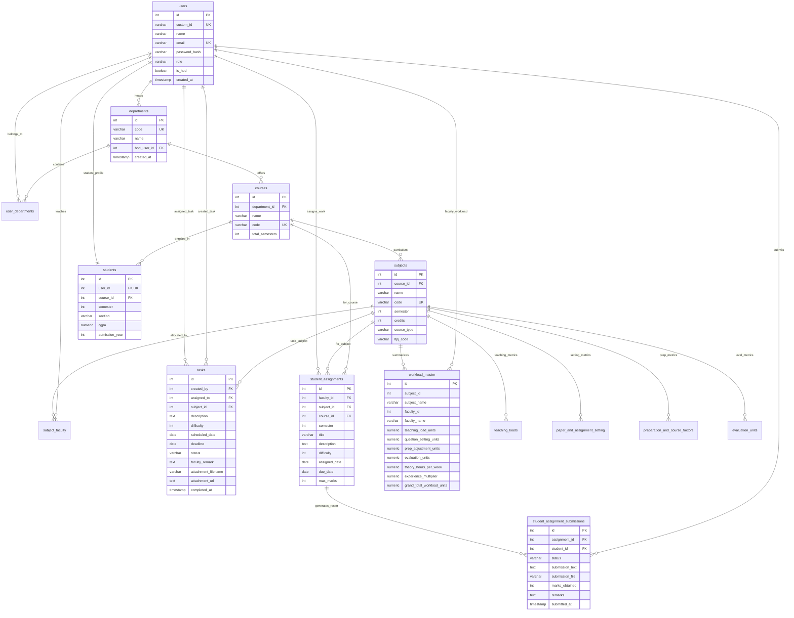

# UniFlow — Database Design & Schema Specifications

## 1. Database Overview & Environment

- **Database Engine:** PostgreSQL 16+
- **Database Name:** `uniflow` (development database configured in `.env`)
- **Default Port:** `5432`
- **Encoding:** UTF-8
- **Primary Schema Definition File:** `backend/schema.sql`
- **Dynamic Startup Migrations (`backend/src/server.js`):** Auto-migrates `tasks` columns (`faculty_remark`, `attachment_filename`, `attachment_url`, `completed_at`) if missing.
- **Academic Tables DDL Scripts:**
  - `backend/create_workload_tables.js` (creates `teaching_loads`, `workload_master`)
  - `backend/create_setting_units_table.js` (creates `paper_and_assignment_setting`)
  - `backend/create_preparation_table.js` (creates `preparation_and_course_factors`)
  - `backend/create_evaluation_table.js` (creates `evaluation_units`)
  - `backend/alter_workload_tables.js` (adds `subject_name`, `faculty_name` across all 5 tables)

---

## 2. Complete Data Dictionary (15 Relational Tables)

### Table 1: `users`
Primary authentication and user profile table.
| Column | Type | Constraints | Description |
| :--- | :--- | :--- | :--- |
| `id` | SERIAL | PRIMARY KEY | Unique surrogate identifier. |
| `custom_id` | VARCHAR(50) | UNIQUE, NULLABLE | Institutional identifier (e.g., `FAC001`, `STU001`, `HOD-CS01`). |
| `name` | VARCHAR(255) | NOT NULL | Full personal name. |
| `email` | VARCHAR(255) | UNIQUE, NOT NULL | Authentication username / institutional email. |
| `password_hash` | VARCHAR(255) | NOT NULL | Bcrypt hash (10 salt rounds). |
| `role` | VARCHAR(50) | NOT NULL | Role designation: `'admin'`, `'faculty'`, `'student'`. |
| `is_hod` | BOOLEAN | DEFAULT FALSE | Boolean flag distinguishing Head of Department. |
| `created_at` | TIMESTAMP | DEFAULT CURRENT_TIMESTAMP | Account creation timestamp. |

---

### Table 2: `departments`
Academic departments within the institution.
| Column | Type | Constraints | Description |
| :--- | :--- | :--- | :--- |
| `id` | SERIAL | PRIMARY KEY | Unique department identifier. |
| `code` | VARCHAR(50) | UNIQUE, NOT NULL | Department code (e.g., `DEP-CS01`, `DEP-ME02`). |
| `name` | VARCHAR(255) | NOT NULL | Full department title (e.g., `Computer Science`). |
| `hod_user_id` | INT | FK $\rightarrow$ `users(id)`, `ON DELETE SET NULL` | Reference to user holding HOD tenure. |
| `created_at` | TIMESTAMP | DEFAULT CURRENT_TIMESTAMP | Department creation timestamp. |

---

### Table 3: `user_departments`
Junction table mapping users to departments.
| Column | Type | Constraints | Description |
| :--- | :--- | :--- | :--- |
| `id` | SERIAL | PRIMARY KEY | Surrogate primary key. |
| `user_id` | INT | FK $\rightarrow$ `users(id)`, `ON DELETE CASCADE` | Associated user. |
| `department_id` | INT | FK $\rightarrow$ `departments(id)`, `ON DELETE CASCADE` | Associated department. |
| *Composite* | UNIQUE | `UNIQUE(user_id, department_id)` | Prevents duplicate department mappings. |

---

### Table 4: `courses`
Academic degree programs offered under departments.
| Column | Type | Constraints | Description |
| :--- | :--- | :--- | :--- |
| `id` | SERIAL | PRIMARY KEY | Unique course identifier. |
| `department_id` | INT | FK $\rightarrow$ `departments(id)`, `ON DELETE CASCADE` | Owning academic department. |
| `name` | VARCHAR(255) | NOT NULL | Course title (e.g., `B.Tech Computer Science and Engineering`). |
| `code` | VARCHAR(50) | UNIQUE, NOT NULL | Course code (e.g., `CSE`, `MCA`). |
| `total_semesters`| INT | DEFAULT 8 | Total academic semesters in curriculum. |
| `created_at` | TIMESTAMP | DEFAULT CURRENT_TIMESTAMP | Course creation timestamp. |

---

### Table 5: `subjects`
Individual curricular subjects/modules belonging to a course.
| Column | Type | Constraints | Description |
| :--- | :--- | :--- | :--- |
| `id` | SERIAL | PRIMARY KEY | Unique subject identifier. |
| `course_id` | INT | FK $\rightarrow$ `courses(id)`, `ON DELETE CASCADE` | Associated academic course. |
| `name` | VARCHAR(255) | NOT NULL | Subject title (e.g., `Operating Systems`). |
| `code` | VARCHAR(50) | UNIQUE, NOT NULL | Curriculum subject code (e.g., `CS301`). |
| `semester` | INT | NOT NULL | Semester number in which subject is taught (e.g., `5`). |
| `credits` | INT | DEFAULT 3 | Academic credits assigned. |
| `course_type` | VARCHAR(255) | NULLABLE | Pedagogical type (e.g., Theory, Lab, Tutorial embedded). |
| `ltpj_code` | VARCHAR(50) | NULLABLE | L-T-P-J structure code (e.g., `3-1-0-0`, `2-1-2-0`). |
| `created_at` | TIMESTAMP | DEFAULT CURRENT_TIMESTAMP | Record creation timestamp. |

---

### Table 6: `subject_faculty`
Allocation table assigning faculty members to subjects.
| Column | Type | Constraints | Description |
| :--- | :--- | :--- | :--- |
| `id` | SERIAL | PRIMARY KEY | Surrogate identifier. |
| `subject_id` | INT | FK $\rightarrow$ `subjects(id)`, `ON DELETE CASCADE` | Allocated subject. |
| `faculty_id` | INT | FK $\rightarrow$ `users(id)`, `ON DELETE CASCADE` | Assigned faculty member. |
| `role` | VARCHAR(50) | DEFAULT 'Theory' | In-charge role: `'Theory'`, `'Lab'`, `'Project'`. |
| *Composite* | UNIQUE | `UNIQUE(subject_id, faculty_id)` | Prevents duplicate teacher allocation to same subject. |

---

### Table 7: `tasks`
Administrative task allocations created by HOD for faculty.
| Column | Type | Constraints | Description |
| :--- | :--- | :--- | :--- |
| `id` | SERIAL | PRIMARY KEY | Unique task identifier. |
| `created_by` | INT | FK $\rightarrow$ `users(id)`, `ON DELETE SET NULL` | Assigning HOD user ID. |
| `assigned_to` | INT | FK $\rightarrow$ `users(id)`, `ON DELETE CASCADE` | Target faculty member ID. |
| `subject_id` | INT | FK $\rightarrow$ `subjects(id)`, `ON DELETE SET NULL` | Optional associated subject context. |
| `description` | TEXT | NOT NULL | Description of work or administrative duty. |
| `difficulty` | INT | NOT NULL, `CHECK (difficulty BETWEEN 1 AND 10)` | Complexity rating (1=Light, 10=Exhaustive). |
| `deadline` | DATE | NULLABLE | Target completion deadline date. |
| `scheduled_date` | DATE | NULLABLE | Start or assigned execution date. |
| `status` | VARCHAR(50) | DEFAULT 'pending' | Status: `'pending'`, `'in_progress'`, `'completed'`, `'approved'`. |
| `faculty_remark` | TEXT | NULLABLE | Deliverable notes submitted by faculty. |
| `attachment_filename` | VARCHAR(255) | NULLABLE | Original uploaded file name. |
| `attachment_url` | TEXT | NULLABLE | Static URL to uploaded deliverable file. |
| `completed_at` | TIMESTAMP | NULLABLE | Timestamp when marked completed. |
| `created_at` | TIMESTAMP | DEFAULT CURRENT_TIMESTAMP | Creation timestamp. |

---

### Table 8: `students`
Student enrollment profiles and academic standing.
| Column | Type | Constraints | Description |
| :--- | :--- | :--- | :--- |
| `id` | SERIAL | PRIMARY KEY | Unique student profile identifier. |
| `user_id` | INT | UNIQUE, NOT NULL, FK $\rightarrow$ `users(id)`, `CASCADE` | Linked user account. |
| `course_id` | INT | NOT NULL, FK $\rightarrow$ `courses(id)`, `CASCADE` | Enrolled degree program. |
| `semester` | INT | NOT NULL, DEFAULT 5 | Current active semester. |
| `section` | VARCHAR(10)| DEFAULT 'A' | Class section division. |
| `cgpa` | NUMERIC(3,2)| DEFAULT 8.40 | Cumulative Grade Point Average. |
| `admission_year`| INT | DEFAULT 2023 | Batch enrollment year. |
| `created_at` | TIMESTAMP | DEFAULT CURRENT_TIMESTAMP | Profile creation timestamp. |

---

### Table 9: `student_assignments`
Course assignments published by faculty for a class.
| Column | Type | Constraints | Description |
| :--- | :--- | :--- | :--- |
| `id` | SERIAL | PRIMARY KEY | Unique assignment identifier. |
| `faculty_id` | INT | NOT NULL, FK $\rightarrow$ `users(id)`, `CASCADE` | Faculty member who assigned the work. |
| `subject_id` | INT | NOT NULL, FK $\rightarrow$ `subjects(id)`, `CASCADE` | Subject for which assignment is given. |
| `course_id` | INT | NOT NULL, FK $\rightarrow$ `courses(id)`, `CASCADE` | Target degree course. |
| `semester` | INT | NOT NULL | Target class semester. |
| `title` | VARCHAR(255)| NOT NULL | Assignment title. |
| `description` | TEXT | NOT NULL | Scope, instructions, and deliverables. |
| `difficulty` | INT | NOT NULL, `CHECK (difficulty BETWEEN 1 AND 10)` | Workload weight (1–10). |
| `assigned_date` | DATE | DEFAULT CURRENT_DATE | Issue date. |
| `due_date` | DATE | NOT NULL | Final submission deadline. |
| `max_marks` | INT | DEFAULT 100 | Maximum grading marks. |
| `created_at` | TIMESTAMP | DEFAULT CURRENT_TIMESTAMP | Publishing timestamp. |

---

### Table 10: `student_assignment_submissions`
Individual student submission status and evaluation.
| Column | Type | Constraints | Description |
| :--- | :--- | :--- | :--- |
| `id` | SERIAL | PRIMARY KEY | Unique submission identifier. |
| `assignment_id` | INT | NOT NULL, FK $\rightarrow$ `student_assignments(id)`, `CASCADE` | Target assignment. |
| `student_id` | INT | NOT NULL, FK $\rightarrow$ `users(id)`, `CASCADE` | Student user account. |
| `status` | VARCHAR(50) | DEFAULT 'pending' | Status: `'pending'`, `'submitted'`, `'graded'`. |
| `submission_text`| TEXT | NULLABLE | Online notes, repository link, or submission text. |
| `submission_file`| VARCHAR(255)| NULLABLE | Path to uploaded document if any. |
| `marks_obtained`| INT | NULLABLE | Awarded marks. |
| `remarks` | TEXT | NULLABLE | Faculty evaluation remarks. |
| `submitted_at` | TIMESTAMP | NULLABLE | Timestamp of online turn-in. |
| `created_at` | TIMESTAMP | DEFAULT CURRENT_TIMESTAMP | Auto-generation timestamp. |
| *Composite* | UNIQUE | `UNIQUE(assignment_id, student_id)` | Exactly one submission record per student per assignment. |

---

### Tables 11–15: Academic Workload Analytics Tables

#### Table 11: `teaching_loads`
| Column | Type | Constraints | Description |
| :--- | :--- | :--- | :--- |
| `id` | SERIAL | PRIMARY KEY | Identifier. |
| `subject_id` | INTEGER | NULLABLE | Subject reference. |
| `subject_name` | VARCHAR(255) | NULLABLE | Name of subject. |
| `faculty_id` | INTEGER | NULLABLE | Faculty reference. |
| `faculty_name` | VARCHAR(255) | NULLABLE | Faculty member name. |
| `students_in_class` | INTEGER | DEFAULT 60 | Enrolled class strength. |
| `theory_hours` | NUMERIC | DEFAULT 0 | Lecture (L) hours/week. |
| `lab_hours` | NUMERIC | DEFAULT 0 | Practical (P) hours/week. |
| `project_hours`| NUMERIC | DEFAULT 0 | Project (J) hours/week. |
| `tutorial_hours`| NUMERIC | DEFAULT 0 | Tutorial (T) hours/week. |
| `students_in_lab`| INTEGER | DEFAULT 0 | Students supervised in laboratory. |
| `students_in_project`| INTEGER| DEFAULT 0 | Students mentored for project. |
| `subtotal_weighted_units`| NUMERIC| DEFAULT 0 | Weighted teaching sum. |
| `total_load` | NUMERIC | DEFAULT 0 | Final teaching load score. |

#### Table 12: `paper_and_assignment_setting`
| Column | Type | Constraints | Description |
| :--- | :--- | :--- | :--- |
| `id` | SERIAL | PRIMARY KEY | Identifier. |
| `subject_id` | INTEGER | NULLABLE | Subject reference. |
| `subject_name` | VARCHAR(255) | NULLABLE | Name of subject. |
| `faculty_id` | INTEGER | NULLABLE | Faculty reference. |
| `faculty_name` | VARCHAR(255) | NULLABLE | Faculty member name. |
| `num_question_papers` | INTEGER | DEFAULT 0 | Count of question papers set. |
| `num_assignments` | INTEGER | DEFAULT 2 | Count of assignments formulated. |
| `num_question_bank` | INTEGER | DEFAULT 0 | Question bank contributions. |
| `subtotal_setting_units`| NUMERIC | DEFAULT 0 | Weighted question setting load. |

#### Table 13: `preparation_and_course_factors`
| Column | Type | Constraints | Description |
| :--- | :--- | :--- | :--- |
| `id` | SERIAL | PRIMARY KEY | Identifier. |
| `subject_id` | INTEGER | NULLABLE | Subject reference. |
| `subject_name` | VARCHAR(255) | NULLABLE | Subject name. |
| `faculty_id` | INTEGER | NULLABLE | Faculty reference. |
| `faculty_name` | VARCHAR(255) | NULLABLE | Faculty member name. |
| `theory_subject_prep` | NUMERIC | DEFAULT 0 | Theory prep units (2.0). |
| `theory_rubrics_prep` | NUMERIC | DEFAULT 0 | Rubric preparation units (2.0). |
| `theory_copo_mapping` | NUMERIC | DEFAULT 0 | Course-Outcome/Program-Outcome mapping (2.0). |
| `lab_experiments_prep`| NUMERIC | DEFAULT 0 | Laboratory manual/experiment prep. |
| `lab_rubrics_prep` | NUMERIC | DEFAULT 0 | Lab rubrics units. |
| `lab_eval_sheets_prep`| NUMERIC | DEFAULT 0 | Continuous evaluation sheet prep. |
| `lab_copo_mapping` | NUMERIC | DEFAULT 0 | Lab CO-PO mapping. |
| `project_rubrics_prep`| NUMERIC | DEFAULT 0 | Project rubrics prep. |
| `project_eval_sheets_prep`| NUMERIC | DEFAULT 0 | Project evaluation sheet prep. |
| `project_copo_mapping`| NUMERIC | DEFAULT 0 | Project CO-PO mapping. |
| `project_scheduling` | NUMERIC | DEFAULT 0 | Review scheduling units. |
| `extra_additions` | NUMERIC | DEFAULT 0 | Lab modification allowance (0.5 or 2.0). |
| `total_load` | NUMERIC | DEFAULT 0 | Subtotal preparation units. |

#### Table 14: `evaluation_units`
| Column | Type | Constraints | Description |
| :--- | :--- | :--- | :--- |
| `id` | SERIAL | PRIMARY KEY | Identifier. |
| `subject_id` | INTEGER | NULLABLE | Subject reference. |
| `subject_name` | VARCHAR(255) | NULLABLE | Subject name. |
| `faculty_id` | INTEGER | NULLABLE | Faculty member reference. |
| `faculty_name` | VARCHAR(255) | NULLABLE | Faculty member name. |
| `series_answer_scripts`| NUMERIC| DEFAULT 0 | Total series internal scripts evaluated. |
| `end_sem_answer_scripts`| NUMERIC| DEFAULT 0 | End-semester valuation scripts. |
| `assignment_scripts` | NUMERIC | DEFAULT 0 | Assignment submissions evaluated. |
| `lab_output_evaluations`| NUMERIC| DEFAULT 0 | Weekly lab output assessments. |
| `practical_exam_evals` | NUMERIC | DEFAULT 0 | Lab practical examination evaluations. |
| `viva_voce_count` | NUMERIC | DEFAULT 0 | Project viva-voce assessments. |
| `project_evaluations` | NUMERIC | DEFAULT 0 | Comprehensive project milestone reviews. |
| `subtotal_evaluation_units`| NUMERIC| DEFAULT 0 | Subtotal evaluation load score. |

#### Table 15: `workload_master`
| Column | Type | Constraints | Description |
| :--- | :--- | :--- | :--- |
| `id` | SERIAL | PRIMARY KEY | Identifier. |
| `subject_id` | INTEGER | NULLABLE | Subject reference. |
| `subject_name` | VARCHAR(255) | NULLABLE | Subject name. |
| `faculty_id` | INTEGER | NULLABLE | Faculty member reference. |
| `faculty_name` | VARCHAR(255) | NULLABLE | Faculty member name. |
| `teaching_load_units` | NUMERIC | DEFAULT 0 | Load units from `teaching_loads`. |
| `question_setting_units`| NUMERIC| DEFAULT 0 | Load units from `paper_and_assignment_setting`. |
| `prep_adjustment_units`| NUMERIC | DEFAULT 0 | Load units from `preparation_and_course_factors`. |
| `evaluation_units` | NUMERIC | DEFAULT 0 | Load units from `evaluation_units`. |
| `theory_hours_per_week`| NUMERIC | DEFAULT 0 | Pure lecture hours. |
| `experience_multiplier`| NUMERIC | DEFAULT 1.0 | 0.9 if prior experience $>0$ semesters; 1.0 otherwise. |
| `grand_total_workload_units`| NUMERIC| DEFAULT 0 | $(TL + SL + PL + EL) \times \text{Multiplier}$. |

---

## 3. Comprehensive Entity-Relationship (ER) Diagram (Mermaid)

