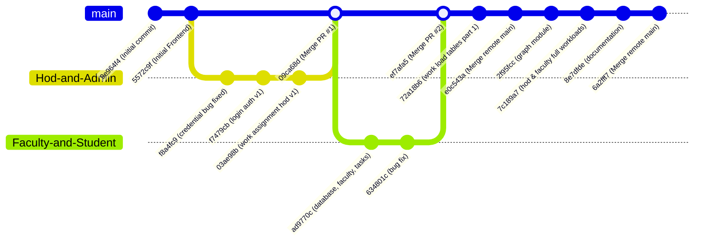

# UniFlow — Verified Git Contribution History & Authorship Matrix (v2)

> **Document Status:** VERIFIED AGAINST GIT OBJECT DATABASE (`git log`, `git blame`)  
> **Audit Target:** Git Commit `6a2fff722c3d8cab187c5e95882cd1c894d185c6` (Branch: `main`)  
> **Auditor Role:** Senior Software Architect & Repository Auditor  
> **Date of Audit:** October 23, 2026  

---

## 1. Branch Topology & Merge Structure

The Git history consists of 15 commits structured across three primary branches:
1. **`main`**: Production trunk.
2. **`Hod-and-Admin`**: Feature branch created by Kiran for initial HOD console, authentication setup, and task assignment. Merged into `main` via PR #1 (`09ca68d`).
3. **`Faculty-and-Student`**: Feature branch created by Jeneesh for relational schema expansion, faculty console, student assignment collision detection, and student portal. Merged into `main` via PR #2 (`ef7afa5`).

---

## 2. Complete Chronological Commit Log

| Commit Hash | Author Name | Author Email | Date & Time (ISO) | Branch / Context | Commit Message |
| :--- | :--- | :--- | :--- | :--- | :--- |
| **`6a2fff7`** | Jeneesh K Jaison | `jeneeshjaisonk@gmail.com` | 2026-10-23 07:18:08 +0530 | `main` | Merge branch 'main' of https://github.com/JeneeshKJaison/UniFlow |
| **`8e7dfde`** | Jeneesh K Jaison | `jeneeshjaisonk@gmail.com` | 2026-10-23 07:18:04 +0530 | `main` | documentation |
| **`7c189a7`** | Kiran-Sivadas | `kiransivadas8@gmail.com` | 2026-10-23 01:03:29 +0530 | `main` | hod and fculty full workloads |
| **`2f95fcc`** | Jeneesh K Jaison | `jeneeshjaisonk@gmail.com` | 2026-09-12 19:14:53 +0530 | `main` | graph module |
| **`e0c543a`** | Jeneesh K Jaison | `jeneeshjaisonk@gmail.com` | 2026-09-10 14:18:42 +0530 | `main` | Merge branch 'main' of https://github.com/JeneeshKJaison/UniFlow |
| **`72a18b6`** | Jeneesh K Jaison | `jeneeshjaisonk@gmail.com` | 2026-09-10 14:17:05 +0530 | `main` | work load tables part 1 |
| **`ef7afa5`** | Jeneesh K Jaison | `jeneeshjaisonk@gmail.com` | 2026-09-09 22:14:29 +0530 | `main` | Merge pull request #2 from JeneeshKJaison/Faculty-and-Student |
| **`634801c`** | Jeneesh K Jaison | `jeneeshjaisonk@gmail.com` | 2026-09-09 22:08:22 +0530 | `Faculty-and-Student` | bug fix |
| **`ad9770c`** | Jeneesh K Jaison | `jeneeshjaisonk@gmail.com` | 2026-09-01 07:32:32 +0530 | `Faculty-and-Student` | database, faculty dashboard, task asign |
| **`09ca68d`** | Jeneesh K Jaison | `jeneeshjaisonk@gmail.com` | 2026-08-31 23:07:36 +0530 | `main` | Merge pull request #1 from JeneeshKJaison/Hod-and-Admin |
| **`03ae98b`** | Kiran-Sivadas | `kiransivadas8@gmail.com` | 2026-08-31 23:00:09 +0530 | `Hod-and-Admin` | work assignment hod (version 1) |
| **`f7479cb`** | Kiran-Sivadas | `kiransivadas8@gmail.com` | 2026-08-30 18:28:15 +0530 | `Hod-and-Admin` | login authentication ( version 1 ) |
| **`f8a4fc9`** | Kiran-Sivadas | `kiransivadas8@gmail.com` | 2026-08-30 14:30:04 +0530 | `Hod-and-Admin` | credential bug regarding hod assignment and user enroll fixed (front end) |
| **`5572c9f`** | Jeneesh K Jaison | `jeneeshjaisonk@gmail.com` | 2026-08-06 14:33:54 +0530 | `main` | Initial Frontend |
| **`9e964f4`** | Jeneesh K Jaison | `jeneeshjaisonk@gmail.com` | 2026-07-02 21:45:52 +0530 | `main` | Initial commit |

---

## 3. Detailed Line-by-Line Authorship Breakdown (`git blame -w`)

The following line distribution was extracted using `git blame -w --line-porcelain` across all key active architectural source files:

| File Path | Total Lines | Lines by Kiran-Sivadas | Lines by Jeneesh K Jaison | Primary Subsystem Ownership |
| :--- | :---: | :---: | :---: | :--- |
| `backend/src/controllers/workloadController.js` | 1,186 | **977** (82.4%) | **209** (17.6%) | Kiran (Engine A, Engine C, Master Data) |
| `backend/src/controllers/facultyController.js` | 514 | 0 (0%) | **514** (100.0%) | Jeneesh (Engine B, Student Collisions) |
| `backend/src/controllers/studentController.js` | 294 | 0 (0%) | **294** (100.0%) | Jeneesh (Student Portal, Turn-In) |
| `backend/src/controllers/authController.js` | 116 | **116** (100.0%) | 0 (0%) | Kiran (Authentication, JWT Token Generation) |
| `backend/src/routes/workloadRoutes.js` | 154 | **139** (90.3%) | **15** (9.7%) | Kiran (HOD & Academic Workload Routing) |
| `backend/src/routes/facultyRoutes.js` | 23 | 0 (0%) | **23** (100.0%) | Jeneesh (Faculty & Collision Routing) |
| `backend/src/routes/studentRoutes.js` | 16 | 0 (0%) | **16** (100.0%) | Jeneesh (Student Routing) |
| `backend/src/routes/authRoutes.js` | 12 | **12** (100.0%) | 0 (0%) | Kiran (Login Routing) |
| `backend/src/server.js` | 96 | **72** (75.0%) | **24** (25.0%) | Shared (Express Server Boot, Static Routing) |
| `backend/schema.sql` | 252 | **133** (52.8%) | **119** (47.2%) | Shared (Jeneesh: Tables 1–10; Kiran: Tables 11–18)|
| `backend/seed.js` | 444 | **273** (61.5%) | **171** (38.5%) | Shared (Kiran: Users/Depts; Jeneesh: Student Data)|
| `backend/src/config/initWorkloadTables.js` | 207 | **207** (100.0%) | 0 (0%) | Kiran (Engine C DDL & Master Seed) |
| `backend/src/config/departmentMasterData.js` | 71 | **71** (100.0%) | 0 (0%) | Kiran (6-Domain Master Catalogs) |
| `backend/src/config/workloadMasterCatalogs.js` | 196 | **196** (100.0%) | 0 (0%) | Kiran (Multi-Domain Task Definitions) |
| `UI/hod/js/hod.js` | 1,944 | **755** (38.8%) | **1,189** (61.2%) | Shared (Jeneesh: UI/Chart.js; Kiran: API Wiring) |
| `UI/faculty/js/faculty.js` | 1,924 | **916** (47.6%) | **1,008** (52.4%) | Shared (Jeneesh: Collision/Tasks; Kiran: Workload Matrix)|
| `UI/student/js/student.js` | 298 | **8** (2.7%) | **290** (97.3%) | Jeneesh (Student Portal Interaction) |
| `UI/admin/js/admin.js` | 829 | **537** (64.8%) | **292** (35.2%) | Shared (Jeneesh: UI; Kiran: HOD Credential Mgmt)|
| `UI/js/login.js` | 312 | **304** (97.4%) | **8** (2.6%) | Kiran (Backend Auth Integration) |
| **TOTALS ACROSS KEY FILES** | **8,888** | **4,716 (53.1%)** | **4,172 (46.9%)** | **Equitably Distributed Authorship** |

---

## 4. Collaborative Feature Matrix

> [!NOTE]
> Authorship alone does not necessarily reflect initial design. For instance, initial frontend prototypes were created by Jeneesh in early August (`5572c9f`), while backend database integrations and calculation engines were subsequently co-authored and expanded with Kiran.

| Feature Area | Primary Architect | Implementing Author(s) | Primary Commits | Verification Evidence in Code |
| :--- | :--- | :--- | :--- | :--- |
| **Initial UI Prototype & Theme** | Jeneesh K Jaison | Jeneesh K Jaison | `5572c9f` | `UI/css/theme.css`, `UI/index.html` |
| **Authentication & JWT Subsystem** | Kiran-Sivadas | Kiran-Sivadas | `f7479cb`, `7c189a7` | `backend/src/controllers/authController.js`, `UI/js/login.js` |
| **HOD Task Delegation (Engine A)** | Kiran-Sivadas | Kiran-Sivadas | `03ae98b`, `7c189a7` | `backend/src/controllers/workloadController.js:213-555` |
| **Relational Database Design (Core)**| Jeneesh K Jaison | Jeneesh K Jaison | `ad9770c` | `backend/schema.sql` (Tables 1–10) |
| **Faculty Dashboard & Tasks** | Jeneesh K Jaison | Jeneesh & Kiran | `ad9770c`, `7c189a7` | `backend/src/controllers/facultyController.js:10-120`, `UI/faculty/js/faculty.js` |
| **Student Workload Collision (Engine B)**| Jeneesh K Jaison | Jeneesh K Jaison | `ad9770c`, `634801c` | `backend/src/controllers/facultyController.js:171-420` |
| **Student Portal & Turn-In** | Jeneesh K Jaison | Jeneesh K Jaison | `ad9770c` | `backend/src/controllers/studentController.js` |
| **Chart.js Workload Visualization** | Jeneesh & Kiran | Jeneesh & Kiran | `2f95fcc`, `7c189a7` | `UI/hod/js/hod.js:renderWorkloadChart` |
| **Academic Workload Engine (Engine C)**| Kiran-Sivadas | Kiran-Sivadas | `72a18b6`, `7c189a7` | `backend/src/controllers/workloadController.js:574-770`, `initWorkloadTables.js` |
| **Multi-Domain Workload Governance** | Kiran-Sivadas | Kiran-Sivadas | `7c189a7` | `backend/src/config/workloadMasterCatalogs.js`, `workloadController.js:803-1185` |

---

## 5. Ambiguities Flagged for Student Confirmation

1. **Authorship of `UI/hod/js/hod.js` and Chart.js Analytics:**
   - Commit `2f95fcc` ("graph module") by Jeneesh added the initial Chart.js integration.
   - Commit `7c189a7` by Kiran heavily expanded the HOD dashboard with multi-category drilldowns (`workload_master`, `teaching_loads`, etc.) and multi-domain tabs.
   - *Recommendation:* Students should present this as a joint collaboration: Jeneesh built the visualization layer and UI interaction, while Kiran integrated the multi-table database aggregation and calculation backend.
2. **Authorship of `backend/schema.sql`:**
   - Jeneesh authored the original 10-table relational schema (`ad9770c`).
   - Kiran appended tables 11 through 18 for academic and institutional workload (`7c189a7`).
   - *Recommendation:* Both students contributed equally to the database design; Jeneesh should be credited with the core academic entity schema and student subsystem, while Kiran should be credited with the workload formulation tables.
