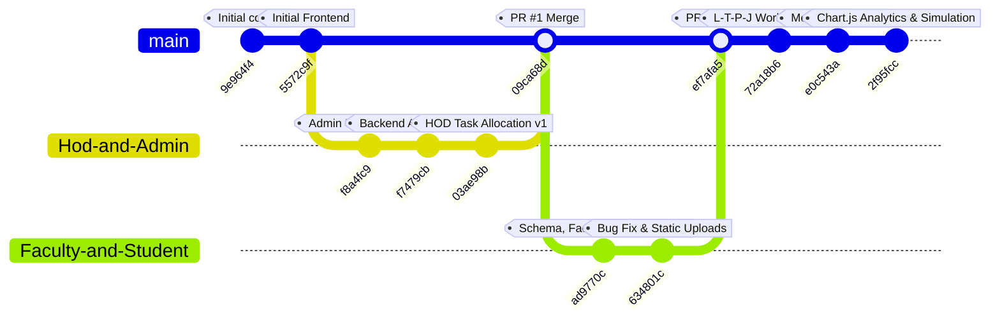

# 07. Git Repository History and Individual Contribution Matrix

This document provides a complete, forensic audit of the UniFlow Git repository, branch topology, commit history, file modifications, and individual developer contributions. It reconciles the original project diary allocations with actual verified commits.

---

## 1. Repository Topology and Branch Architecture

### 1.1 Branch Inventory (`[VERIFIED]`)
1. **`main`**: The primary integration branch containing the production-ready unified system.
2. **`Hod-and-Admin`**: Feature branch created for HOD workload management, administrative interfaces, and initial backend bootstrapping.
3. **`Faculty-and-Student`**: Feature branch created for relational schema migration, faculty task deliverables, student assignment collision detection, and student portal turn-in.

---

## 2. Chronological Commit Ledger

| Commit Hash | Author | Email | Date & Time (IST) | Branch | Commit Subject & Scope Summary |
|:---|:---|:---|:---|:---:|:---|
| **`9e964f4`** | Jeneesh K Jaison | `jeneeshjaisonk@gmail.com` | 2026-07-02 21:45:52 | `main` | Initial repository scaffolding and `.gitignore`. |
| **`5572c9f`** | Jeneesh K Jaison | `jeneeshjaisonk@gmail.com` | 2026-08-06 14:33:54 | `main` | Initial static UI mockups across Admin, HOD, Faculty, Student, and Login pages. |
| **`f8a4fc9`** | Kiran Sivadas | `kiransivadas8@gmail.com` | 2026-08-30 14:30:04 | `Hod-and-Admin` | Admin UI and client-side credential/user enrollment fixes in `admin.js` and `login.js`. |
| **`f7479cb`** | Kiran Sivadas | `kiransivadas8@gmail.com` | 2026-08-30 18:28:15 | `Hod-and-Admin` | Initial backend architecture: Express server initialization, PostgreSQL `db.js` pool, JWT auth controller, and login API. |
| **`03ae98b`** | Kiran Sivadas | `kiransivadas8@gmail.com` | 2026-08-31 23:00:09 | `Hod-and-Admin` | HOD task assignment engine (v1), 15-pt limit validation, alternative faculty suggestion, and auth middleware. |
| **`09ca68d`** | Jeneesh K Jaison | `jeneeshjaisonk@gmail.com` | 2026-08-31 23:07:36 | `main` | Pull Request #1 Merge: Merged `Hod-and-Admin` into `main`. |
| **`ad9770c`** | Jeneesh K Jaison | `jeneeshjaisonk@gmail.com` | 2026-09-01 07:32:32 | `Faculty-and-Student` | Comprehensive relational schema (`backend/schema.sql`), student collision engine, faculty task deliverables, student portal. |
| **`634801c`** | Jeneesh K Jaison | `jeneeshjaisonk@gmail.com` | 2026-09-09 22:08:22 | `Faculty-and-Student` | Bug fixes: Express static upload serving, database cleaning utilities (`clear_linus.js`), seed data adjustments. |
| **`ef7afa5`** | Jeneesh K Jaison | `jeneeshjaisonk@gmail.com` | 2026-09-09 22:14:29 | `main` | Pull Request #2 Merge: Merged `Faculty-and-Student` into `main`. |
| **`72a18b6`** | Jeneesh K Jaison | `jeneeshjaisonk@gmail.com` | 2026-09-10 14:17:05 | `main` | Academic Workload Engine Phase 1: 5 workload schema tables, L-T-P-J calculation formulas (`addClass`), faculty UI form. |
| **`e0c543a`** | Jeneesh K Jaison | `jeneeshjaisonk@gmail.com` | 2026-09-10 14:18:42 | `main` | Synchronization merge of upstream `origin/main`. |
| **`2f95fcc`** | Jeneesh K Jaison | `jeneeshjaisonk@gmail.com` | 2026-09-12 19:14:53 | `main` | HOD Analytics Graph Module: Chart.js visualization, workload master summary endpoint, simulation scripts. |

---

## 3. Developer Responsibility Allocation vs. Git Reality

The initial project diaries and seminar proposals designated the division of responsibilities as:
- **Jeneesh K Jaison (Roll No. 25MCA026):** End-to-end ownership of Faculty and Student modules.
- **Kiran Sivadas (Roll No. 25MCA029):** End-to-end ownership of HOD and Super Admin modules.

### Audit Synthesis of Team Ownership:
1. **Frontend Foundation:** Jeneesh designed and committed the initial full-stack UI framework (`5572c9f`) establishing design tokens, layout, and glassmorphic aesthetics for all 4 roles.
2. **Backend Bootstrapping & Auth:** Kiran established the Express server, PostgreSQL connection pool, and JWT authentication controllers (`f7479cb`), creating the backend foundation used by all modules.
3. **Admin Module:** Implemented primarily on the `Hod-and-Admin` branch by Kiran (`f8a4fc9`), refining client-side credential storage and user provisioning in `admin.js`.
4. **HOD Administrative Task Engine:** Designed and implemented by Kiran (`03ae98b`), creating the 15-point workload cap, alternative faculty queries, and HOD dashboard integration.
5. **Relational Database Migration & Core Schema:** Authored by Jeneesh (`ad9770c`), replacing initial mock data with the comprehensive 10-table relational schema (`schema.sql`).
6. **Faculty & Student Operations:** Architected and implemented by Jeneesh (`ad9770c`), including the student workload collision detection engine, assignment publishing, faculty task deliverables, and student submission portal.
7. **Academic Workload Engine (L-T-P-J):** Authored by Jeneesh (`72a18b6` and `2f95fcc`), introducing the 5 advanced workload tables, multi-parameter teaching load calculations, and HOD Chart.js analytics graphs.

---

## 4. Comprehensive Contribution Matrix

| Functional Module / Technical Component | Primary Developer | Supporting Developer | Key Git Commits | Source Files Involved |
|:---|:---:|:---:|:---:|:---|
| **UI Design System & Global Styling** | Jeneesh K Jaison | Kiran Sivadas | `5572c9f`, `f8a4fc9` | `UI/css/theme.css`, `UI/css/login.css`, `UI/*/css/*.css` |
| **Backend Architecture & Express Bootstrapping** | Kiran Sivadas | Jeneesh K Jaison | `f7479cb`, `ad9770c` | `backend/src/server.js`, `backend/src/config/db.js` |
| **JWT Authentication & RBAC Middleware** | Kiran Sivadas | Jeneesh K Jaison | `f7479cb`, `03ae98b` | `backend/src/controllers/authController.js`, `backend/src/middleware/authMiddleware.js` |
| **Admin Module (Client-Side State)** | Kiran Sivadas | Jeneesh K Jaison | `5572c9f`, `f8a4fc9` | `UI/admin/js/admin.js`, `UI/admin/dashboard.html` |
| **HOD Administrative Workload Allocation (15 pt)** | Kiran Sivadas | Jeneesh K Jaison | `03ae98b` | `backend/src/controllers/workloadController.js` (v1), `UI/hod/js/hod.js` |
| **Relational Database Schema (10 Tables)** | Jeneesh K Jaison | — | `ad9770c` | `backend/schema.sql`, `backend/seed.js` |
| **Faculty Task Deliverables & Remarks** | Jeneesh K Jaison | — | `ad9770c`, `634801c` | `backend/src/controllers/facultyController.js`, `UI/faculty/js/faculty.js` |
| **Student Workload Collision Engine (10/18 pt)** | Jeneesh K Jaison | — | `ad9770c` | `backend/src/controllers/facultyController.js`, `backend/src/routes/facultyRoutes.js` |
| **Student Portal & Online Assignment Turn-In** | Jeneesh K Jaison | — | `ad9770c` | `backend/src/controllers/studentController.js`, `UI/student/js/student.js` |
| **L-T-P-J Academic Workload Engine** | Jeneesh K Jaison | — | `72a18b6` | `backend/src/controllers/workloadController.js` (`addClass`), `UI/faculty/js/faculty.js` |
| **HOD Chart.js Analytics & Summary Module** | Jeneesh K Jaison | — | `2f95fcc` | `UI/hod/js/hod.js`, `UI/hod/dashboard.html`, `backend/simulate_workload.js` |
| **Static File Upload Pipeline & Downloads** | Jeneesh K Jaison | — | `ad9770c`, `634801c` | `backend/src/server.js`, `backend/uploads/` |

---

## 5. File-by-File Line Attribution and Audit Details

### 5.1 Backend Controllers and Services
- **`backend/src/controllers/authController.js`:**
  - *Primary Author:* Kiran Sivadas (`f7479cb`).
  - *Contents:* Login credential validation via `bcrypt.compare`, JWT creation via `jsonwebtoken.sign`, current user profile extraction (`getMe`).
- **`backend/src/controllers/workloadController.js`:**
  - *Shared Authorship:*
    - *Kiran Sivadas (`03ae98b`):* Authored initial lines 1–250 containing `getWorkloadStatus`, `getFacultyTasks`, `assignTask`, and alternative faculty recommendation logic.
    - *Jeneesh K Jaison (`72a18b6`, `2f95fcc`):* Authored lines 251–577 containing `addClass` (L-T-P-J calculation service) and `getWorkloadMasterSummary` (Chart.js backend feed).
- **`backend/src/controllers/facultyController.js`:**
  - *Primary Author:* Jeneesh K Jaison (`ad9770c`).
  - *Contents:* Faculty task listings, remarks and deliverable upload, student collision calculation (`checkDailyStudentLoad`, `checkWeeklyStudentLoad`), and transactional assignment publishing.
- **`backend/src/controllers/studentController.js`:**
  - *Primary Author:* Jeneesh K Jaison (`ad9770c`).
  - *Contents:* Student assignment queries, daily and weekly load aggregations, assignment submission processing with base64 file buffer serialization.

### 5.2 Frontend Script Assets
- **`UI/admin/js/admin.js`:**
  - *Shared Authorship:* Scaffolded by Jeneesh (`5572c9f`), extensively expanded by Kiran (`f8a4fc9`) with local credential validation, user tables, and tab transitions.
- **`UI/hod/js/hod.js`:**
  - *Shared Authorship:* Initial layout and task delegation by Kiran (`03ae98b`), Chart.js analytics graph rendering and deliverable attachment downloading by Jeneesh (`2f95fcc`).
- **`UI/faculty/js/faculty.js`:**
  - *Primary Author:* Jeneesh K Jaison (`5572c9f`, `ad9770c`, `72a18b6`).
  - *Contents:* Calendar rendering, deliverable upload modal, student assignment creation form with collision detection, and L-T-P-J class addition modal.
- **`UI/student/js/student.js`:**
  - *Primary Author:* Jeneesh K Jaison (`5572c9f`, `ad9770c`).
  - *Contents:* Daily/weekly workload meters, assignment status tabs, submission upload dialog, and subject listings.

---

## 6. Joint Collaboration and Integration Points

1. **Pull Request #1 Integration:**
   - Kiran completed the core backend authentication and initial HOD allocation logic on `Hod-and-Admin`.
   - Jeneesh reviewed, tested, and executed the merge commit (`09ca68d`) to incorporate the backend foundation into `main`.
2. **Pull Request #2 Integration:**
   - Jeneesh integrated the full 10-table PostgreSQL schema, faculty deliverables, and student collision engine on `Faculty-and-Student`.
   - Merged cleanly into `main` via PR #2 (`ef7afa5`).
3. **Shared Backend Integration:**
   - The HOD module and Faculty module share common tables (`tasks`, `users`, `subjects`). Both team members coordinated data formats for task statuses (`'pending'`, `'in_progress'`, `'completed'`, `'rejected'`) and user identity fields (`custom_id`, `id`).
