# UniFlow — Diagram-Ready Architecture & Specification Pack (v2)

> **Document Status:** VERIFIED AGAINST CODEBASE & LIVE DATABASE  
> **Audit Target:** Git Commit `6a2fff722c3d8cab187c5e95882cd1c894d185c6` (Branch: `main`)  
> **Auditor Role:** Senior Software Architect, Database Engineer & Technical Illustrator  
> **Date of Audit:** October 23, 2026  

---

## 1. System Architecture & Deployment Diagram

### (a) Purpose
Illustrates the physical and network deployment architecture connecting browser clients, static Express file serving, Node.js API processes, and the PostgreSQL database.

### (b) Node & Edge Specification Table
| Node ID | Element Name | Type | Protocol / Port | Real Name in Code |
| :--- | :--- | :--- | :--- | :--- |
| `CLIENT` | Web Browser | Client Runtime | HTTP / Ports 5000 or 5500 | `UI/index.html`, Chrome/Firefox |
| `SERVER` | Node.js Express Server | Application Process | HTTP / Port 5000 (`process.env.PORT`) | `backend/src/server.js` |
| `STATIC` | Static Middleware | Express Middleware | In-memory path mapping | `express.static('../../UI')` |
| `AUTH_MW`| Auth Middleware | Middleware | In-memory JWT verification | `backend/src/middleware/authMiddleware.js` |
| `PG_POOL`| node-postgres Pool | Client Driver Pool | TCP / Port 5432 | `backend/src/config/db.js` (`new Pool(...)`) |
| `POSTGRES`| PostgreSQL Database | Relational DBMS | Port 5432 (`process.env.DB_PORT`)| Database: `uniflow` |

### (c) Mermaid Source
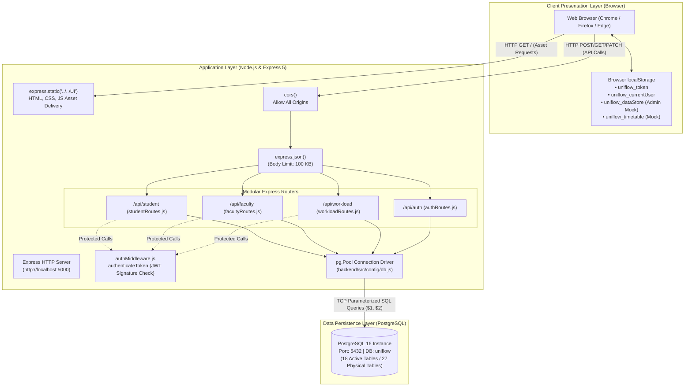

---

## 2. Layered Component Diagram of the Backend

### (a) Purpose
Decomposes the backend into discrete architectural layers (Routes $\rightarrow$ Middleware $\rightarrow$ Controllers $\rightarrow$ Data Access) and enumerates every controller export.

### (b) Component Hierarchy & Function Mapping
- **Routes Layer:** `authRoutes.js`, `workloadRoutes.js`, `facultyRoutes.js`, `studentRoutes.js`.
- **Middleware Layer:** `authMiddleware.js` (`authenticateToken`), `flexibleAuth`, `flexibleHodAuth`.
- **Controllers Layer:**
  - `authController.js`: `login`
  - `workloadController.js`: `getSubjects`, `getFaculty`, `getTasks`, `suggestTask`, `assignTask`, `addClass`, `getHodSummary`, `getWorkloadCatalogs`, `getDepartmentMaster`, `getFacultyDepartmentWorkload`, `saveFacultyDepartmentWorkload`, `deleteFacultyDepartmentWorkload`, `getHodDepartmentSummary`
  - `facultyController.js`: `getMyTasks`, `updateTaskStatus`, `getMySubjects`, `checkStudentWorkload`, `assignWorkToStudents`, `getMyAssignedStudentWorks`
  - `studentController.js`: `getStudentDashboard`, `getStudentAssignments`, `getStudentCourses`, `submitAssignment`
- **Data Access:** `backend/src/config/db.js` (`pool.query`).

### (c) Mermaid Source
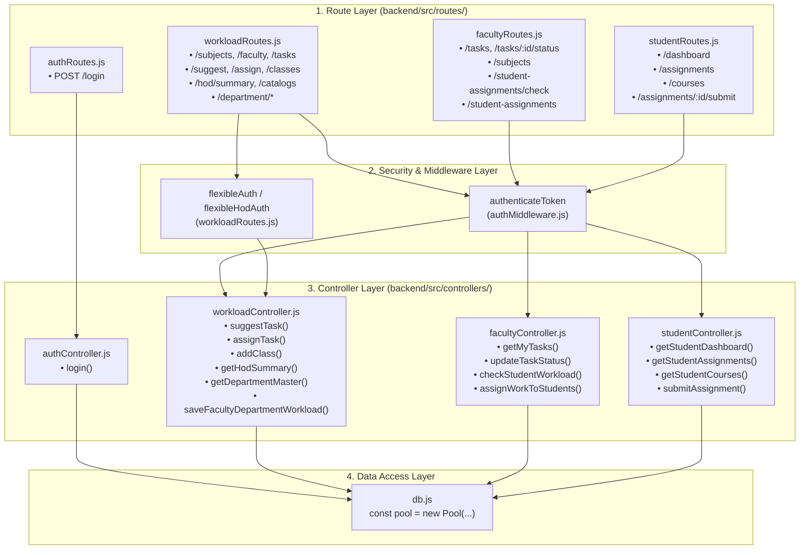

---

## 3. Frontend Structure & Storage Architecture

### (a) Purpose
Maps each frontend HTML view to its associated scripts, stylesheets, API endpoints invoked, and browser `localStorage` keys used.

### (b) Structure Table
| HTML Page | Script File | CSS File | API Routes Invoked | `localStorage` Keys Touched |
| :--- | :--- | :--- | :--- | :--- |
| `UI/index.html` | `UI/js/login.js` | `UI/css/login.css`<br>`UI/css/theme.css` | `POST /api/auth/login` | `uniflow_token`, `uniflow_currentUser` |
| `UI/hod/dashboard.html` | `UI/hod/js/hod.js` | `UI/hod/css/hod.css`<br>`UI/css/theme.css` | `GET /api/workload/faculty`<br>`GET /api/workload/tasks`<br>`GET /api/workload/subjects`<br>`POST /api/workload/suggest`<br>`POST /api/workload/assign`<br>`GET /api/workload/hod/summary`<br>`GET /api/workload/department/hod/summary` | `uniflow_token`, `uniflow_currentUser`, `uniflow_timetable` (Mock), `uniflow_grievances` (Mock) |
| `UI/faculty/dashboard.html` | `UI/faculty/js/faculty.js` | `UI/css/theme.css` | `GET /api/faculty/tasks`<br>`PATCH /api/faculty/tasks/:id/status`<br>`GET /api/faculty/subjects`<br>`POST /api/workload/classes`<br>`POST /api/faculty/student-assignments/check`<br>`POST /api/faculty/student-assignments`<br>`GET /api/workload/catalogs`<br>`GET/POST /api/workload/department/faculty` | `uniflow_token`, `uniflow_currentUser` |
| `UI/student/dashboard.html` | `UI/student/js/student.js` | `UI/student/css/student.css`<br>`UI/css/theme.css` | `GET /api/student/dashboard`<br>`GET /api/student/courses`<br>`GET /api/student/assignments`<br>`PATCH /api/student/assignments/:id/submit` | `uniflow_token`, `uniflow_currentUser` |
| `UI/admin/dashboard.html` | `UI/admin/js/admin.js` | `UI/admin/css/admin.css`<br>`UI/css/theme.css` | *None (All operations client-side)* | `uniflow_dataStore` (Mock departments, courses, users, HODs) |

### (c) Mermaid Source
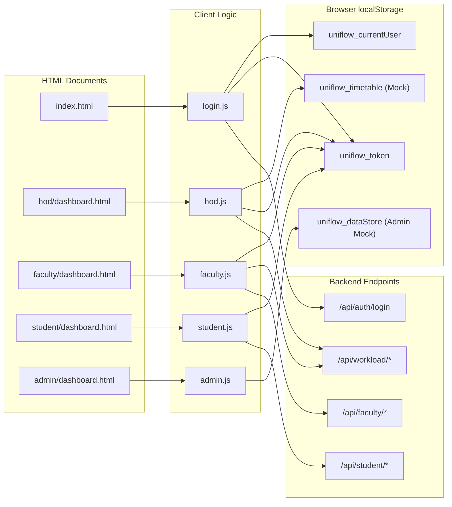

---

## 4. Entity-Relationship (ER) Diagram (Real DDL)

### (a) Purpose
Represents the verified relational schema of the 18 active database tables. Honestly differentiates between core relational tables with foreign keys and academic workload tables that store IDs without foreign key constraints.

### (b) Foreign Key Integrity Legend
- **Solid Relationship Lines (`--||`):** True relational foreign keys enforced by PostgreSQL DDL (`ON DELETE CASCADE` or `SET NULL`).
- **Dashed Relationship Lines (`..o{`):** Logical / Inferred references where columns (`subject_id`, `faculty_id`) store integer keys without database-level `REFERENCES` constraints.

### (c) Mermaid Source
```mermaid
erDiagram
    USERS ||--o{ USER_DEPARTMENTS : "belongs to"
    DEPARTMENTS ||--o{ USER_DEPARTMENTS : "contains"
    DEPARTMENTS ||--o{ COURSES : "offers"
    DEPARTMENTS ||--o| USERS : "headed by (hod_user_id)"
    COURSES ||--o{ SUBJECTS : "curriculum"
    COURSES ||--o{ STUDENTS : "enrolls"
    USERS ||--o| STUDENTS : "profile"
    SUBJECTS ||--o{ SUBJECT_FACULTY : "allocated"
    USERS ||--o{ SUBJECT_FACULTY : "assigned"
    
    USERS ||--o{ TASKS : "delegated to (assigned_to)"
    USERS ||--o{ TASKS : "delegated by (created_by)"
    SUBJECTS ||--o{ TASKS : "context (subject_id)"

    COURSES ||--o{ STUDENT_ASSIGNMENTS : "class cohort"
    SUBJECTS ||--o{ STUDENT_ASSIGNMENTS : "course topic"
    USERS ||--o{ STUDENT_ASSIGNMENTS : "created by (faculty_id)"

    STUDENT_ASSIGNMENTS ||--o{ STUDENT_ASSIGNMENT_SUBMISSIONS : "turn-in"
    USERS ||--o{ STUDENT_ASSIGNMENT_SUBMISSIONS : "submitted by (student_id)"

    DEPARTMENT_ROLES_MASTER ||--o{ DEPARTMENT_TASKS_MASTER : "categorizes (role_id)"
    USERS ||--o{ FACULTY_DEPARTMENT_WORKLOAD : "performed by (faculty_id)"

    %% Unconstrained Logical Relations (Engine C Workload Tables)
    SUBJECTS ..o{ TEACHING_LOADS : "logical subject_id (no FK)"
    USERS ..o{ TEACHING_LOADS : "logical faculty_id (no FK)"
    SUBJECTS ..o{ PAPER_AND_ASSIGNMENT_SETTING : "logical subject_id (no FK)"
    SUBJECTS ..o{ PREPARATION_AND_COURSE_FACTORS : "logical subject_id (no FK)"
    SUBJECTS ..o{ EVALUATION_UNITS : "logical subject_id (no FK)"
    SUBJECTS ..o{ WORKLOAD_MASTER : "logical subject_id (no FK)"
    USERS ..o{ WORKLOAD_MASTER : "logical faculty_id (no FK)"

    USERS {
        int id PK
        varchar custom_id UK
        varchar name
        varchar email UK
        varchar password_hash
        varchar role
        boolean is_hod
    }

    DEPARTMENTS {
        int id PK
        varchar code UK
        varchar name
        int hod_user_id FK
    }

    COURSES {
        int id PK
        int department_id FK
        varchar name
        varchar code UK
        int total_semesters
    }

    SUBJECTS {
        int id PK
        int course_id FK
        varchar name
        varchar code UK
        int semester
        int credits
        varchar course_type
        varchar ltpj_code
    }

    TASKS {
        int id PK
        int created_by FK
        int assigned_to FK
        int subject_id FK
        text description
        int difficulty
        date scheduled_date
        date deadline
        varchar status
    }

    STUDENTS {
        int id PK
        int user_id FK, UK
        int course_id FK
        int semester
        varchar section
        numeric cgpa
    }

    STUDENT_ASSIGNMENTS {
        int id PK
        int faculty_id FK
        int subject_id FK
        int course_id FK
        int semester
        varchar title
        text description
        int difficulty
        date due_date
        int max_marks
    }

    STUDENT_ASSIGNMENT_SUBMISSIONS {
        int id PK
        int assignment_id FK
        int student_id FK
        varchar status
        text submission_text
        varchar submission_file
        timestamp submitted_at
    }

    TEACHING_LOADS {
        int id PK
        int subject_id
        varchar subject_name
        int faculty_id
        varchar faculty_name
        numeric theory_hours
        numeric lab_hours
        numeric project_hours
        numeric tutorial_hours
        numeric total_load
    }

    WORKLOAD_MASTER {
        int id PK
        int subject_id
        varchar subject_name
        int faculty_id
        varchar faculty_name
        numeric teaching_load_units
        numeric question_setting_units
        numeric prep_adjustment_units
        numeric evaluation_units
        numeric experience_multiplier
        numeric grand_total_workload_units
    }

    FACULTY_DEPARTMENT_WORKLOAD {
        int id PK
        int faculty_id FK
        varchar faculty_name
        varchar role_id
        varchar task_id
        varchar task_name
        numeric calculated_workload
        varchar category
    }
```

---

## 5. Context Diagram & Data Flow Diagrams (DFD)

### (a) Purpose
Visualizes information flow across system boundaries (Level 0 Context), major subsystems (Level 1), and calculation engines (Level 2).

### (b) Level 0 Context Diagram
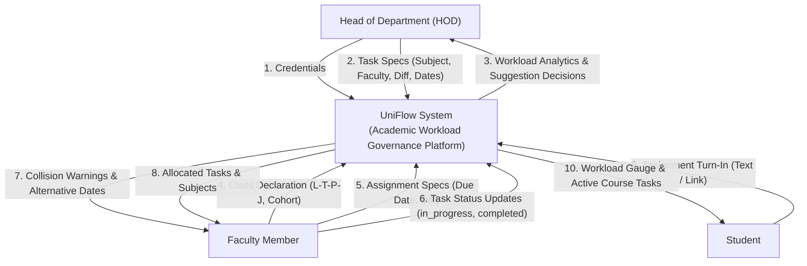

### (c) Level 1 DFD (Decomposed System)
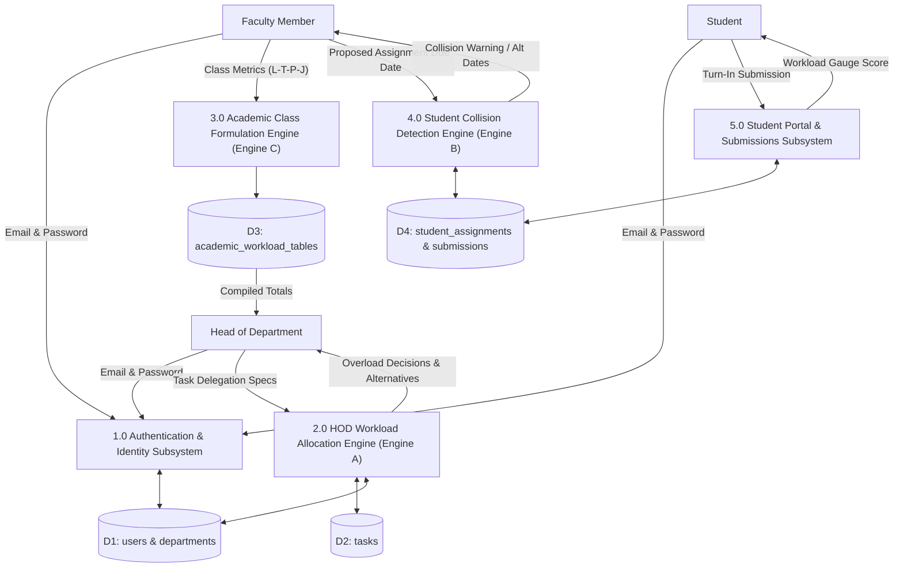

---

## 6. UML Use-Case Diagram

### (a) Purpose
Distinguishes implemented use cases from planned/unconnected features across all four actor roles.

### (b) Mermaid Source
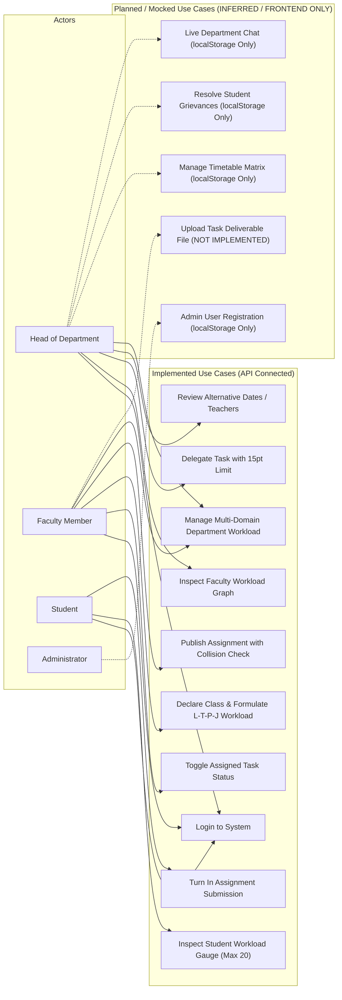

---

## 7. Sequence Diagrams

### 7.1 Login Authentication (`POST /api/auth/login`)
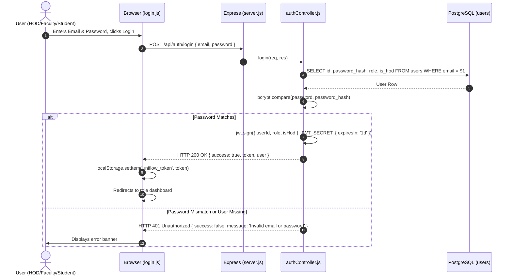

### 7.2 HOD Assigns Task Within 15-Point Limit
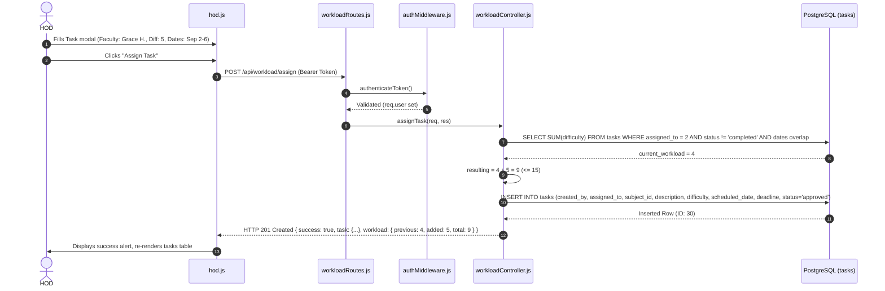

### 7.3 HOD Assigns Task Over 15-Point Limit with Alternative Discovery
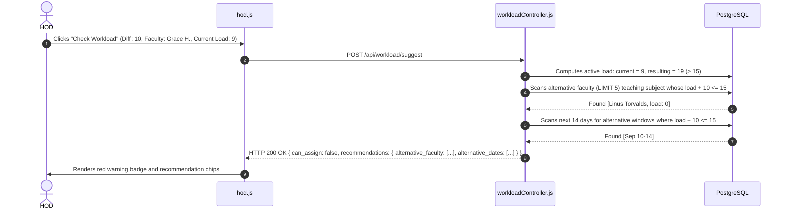

### 7.4 Faculty Publishes Student Assignment with Collision & Override
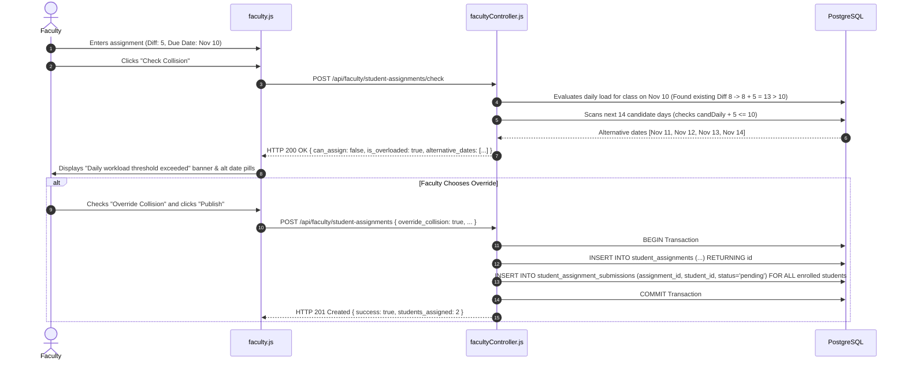

### 7.5 Student Turn-In and Workload Gauge Refresh
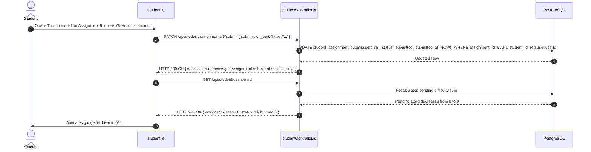

### 7.6 Faculty Declares Class (`addClass` Transactional 5-Table Write)
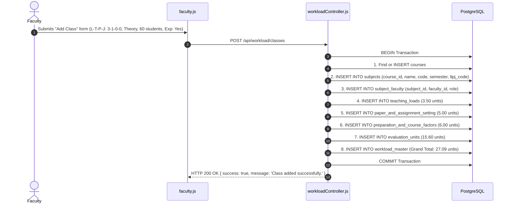

### 7.7 HOD Analytics Chart Load
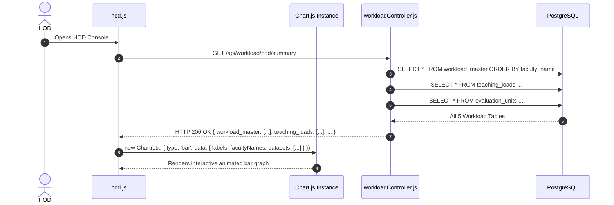

---

## 8. Flowcharts

### 8.1 Flowchart: Engine A (HOD Task Delegation Guard)
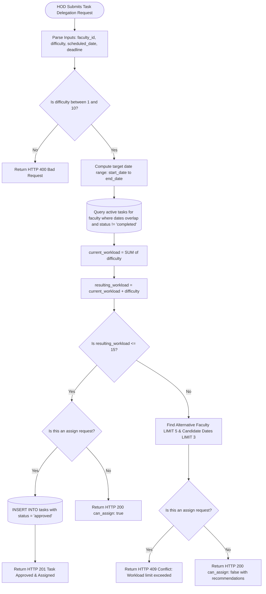

### 8.2 Flowchart: Engine B (Student Workload Collision Engine)
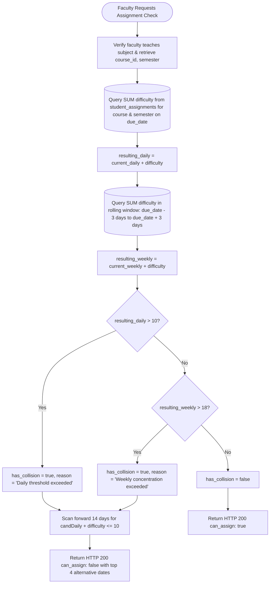

### 8.3 Flowchart: Engine C (L-T-P-J Academic Course Workload Formulation)
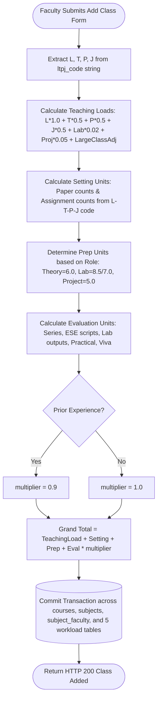

---

## 9. State Transition Diagrams

### 9.1 Administrative Task Status Lifecycle
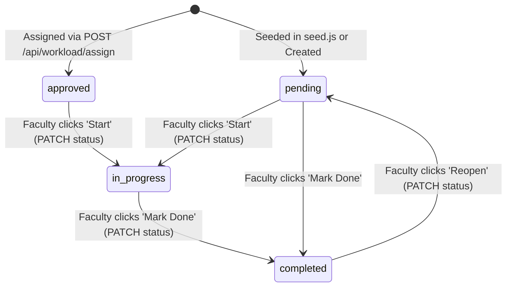

### 9.2 Student Assignment Submission Status Lifecycle
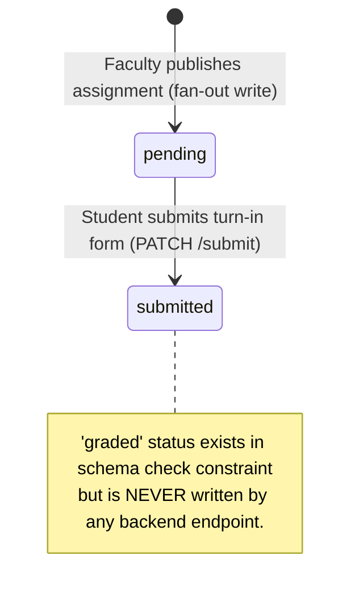

---

## 10. Module & Component Diagram

### (a) Purpose
Illustrates the structural relationship between backend controller modules and frontend client controllers.

### (b) Mermaid Source
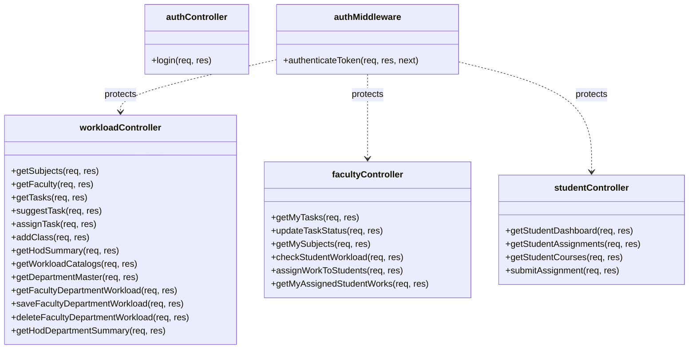

---

## 11. Screen Navigation Flow

### (a) Purpose
Maps user transition between screens, role-based redirects upon login, and modal views.

### (b) Mermaid Source
```mermaid
graph TD
    LoginScreen["Login Screen (UI/index.html)"]
    
    subgraph HOD_Views ["HOD Portal (UI/hod/dashboard.html)"]
        HOD_Dash["HOD Overview & Workload Graph"]
        HOD_TaskModal["Assign Task Modal (Engine A)"]
        HOD_DeptWorkload["Department Workload Matrix"]
        HOD_Timetable["Timetable Matrix (Mock)"]
        HOD_Grievance["Grievance Resolution (Mock)"]
    end

    subgraph Faculty_Views ["Faculty Portal (UI/faculty/dashboard.html)"]
        Fac_Dash["Faculty Overview & Task Table"]
        Fac_AddClassModal["Add Class Modal (Engine C)"]
        Fac_AssignModal["Student Assignment Modal (Engine B)"]
        Fac_Calendar["Calendar View"]
        Fac_DeptWorkload["Faculty Multi-Domain Workload"]
    end

    subgraph Student_Views ["Student Portal (UI/student/dashboard.html)"]
        Stu_Dash["Student Dashboard (20pt Gauge)"]
        Stu_Assignments["Active Assignments List"]
        Stu_TurnInModal["Turn-In Submission Modal"]
        Stu_Courses["Enrolled Courses View"]
    end

    subgraph Admin_Views ["Admin Console (UI/admin/dashboard.html)"]
        Admin_Depts["Departments Directory (Mock)"]
        Admin_Courses["Courses Directory (Mock)"]
        Admin_Users["User Enrollment (Mock)"]
        Admin_Hods["HOD Assignment (Mock)"]
    end

    LoginScreen -- "role === 'hod'" --> HOD_Dash
    LoginScreen -- "role === 'faculty'" --> Fac_Dash
    LoginScreen -- "role === 'student'" --> Stu_Dash
    LoginScreen -- "role === 'admin'" --> Admin_Depts

    HOD_Dash --> HOD_TaskModal
    HOD_Dash --> HOD_DeptWorkload
    HOD_Dash --> HOD_Timetable
    HOD_Dash --> HOD_Grievance

    Fac_Dash --> Fac_AddClassModal
    Fac_Dash --> Fac_AssignModal
    Fac_Dash --> Fac_Calendar
    Fac_Dash --> Fac_DeptWorkload

    Stu_Dash --> Stu_Assignments
    Stu_Assignments --> Stu_TurnInModal
    Stu_Dash --> Stu_Courses

    Admin_Depts --> Admin_Courses --> Admin_Users --> Admin_Hods
```
